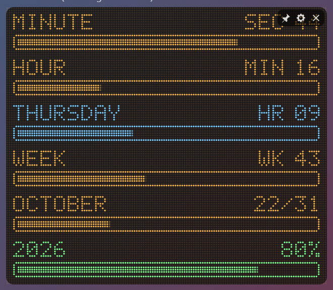
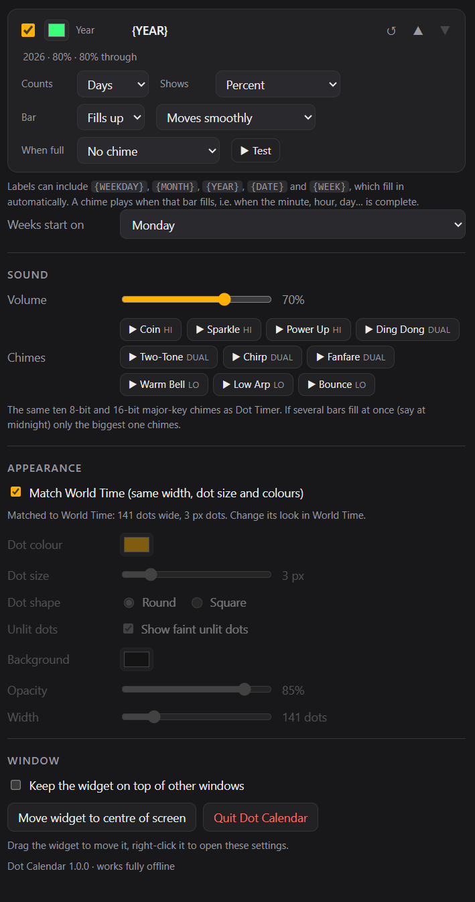
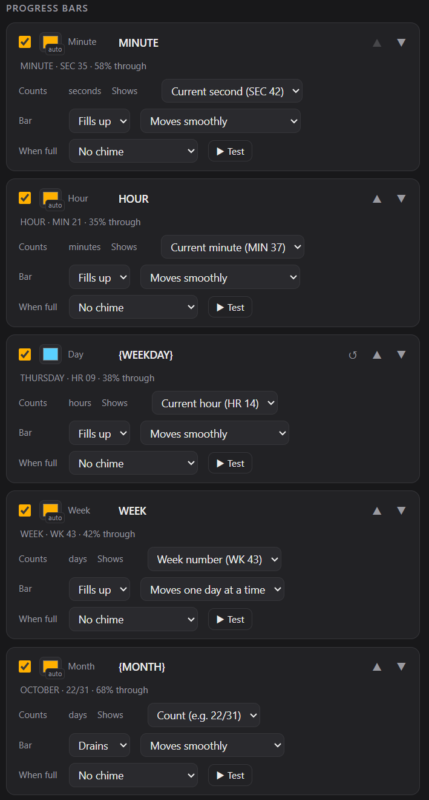

# Dot Calendar

A quietly motivating desktop widget for Windows and macOS. It shows dot-matrix progress bars for how far through the current minute, hour, day, week, month and year you are.

## What it does

Six bars, each of which you can switch on or off and reorder:

| Bar | Counts | Can show |
|---|---|---|
| Minute | seconds | `SEC 42` · `42/60` · `70%` |
| Hour | minutes | `MIN 37` · `37/60` · `61%` |
| Day | hours | `HR 14` · `14/24` · `60%` |
| Week | days | `WK 43` · `4/7` · `48%` |
| Month | days | `22 OCT` · `22/31` · `69%` |
| Year | days, weeks or months | `22 OCT` / `WK 43` / `OCT` · `295/365` · `80%` |

With all six on, it reads as the current second, minute, hour, day, week and month at a glance.

- **Bar direction.** Each bar can **fill up** or **drain**.
- **Bar movement.** Each bar can move smoothly, or step one unit at a time (one hour, one day…).
- **Chimes when full.** Pick any of the same ten 8/16-bit chimes as Dot Timer for when a bar fills. If several fill together, for example at midnight, only the biggest one chimes.
- **Labels that fill themselves in.** A label like `{MONTH}` shows `OCTOBER`. The tokens are `{WEEKDAY}`, `{MONTH}`, `{YEAR}`, `{DATE}` and `{WEEK}`.
- **Colours.** Use one colour for every bar, or give each bar its own.
- **Weeks start on Monday or Sunday.** Week numbers are ISO.
- **Fits with World Time.** It matches World Time's width, dot size and colours, and every row is a fixed size.

## How it works

- **Built the same way as the others.** It uses [Tauri](https://tauri.app) and the same shared display, chime and World Time code as Dot Timer and Dot Focus.
- **Calendar-aware.** Everything follows your computer's local calendar. Days on clock-change dates really have 23 or 25 hours, months have their real length, and leap years are handled.
- **Offline.** It never connects to the internet.

## Building it yourself

See [BUILDING.md](BUILDING.md). The installer is called `Dot Calendar_1.1.0_x64_en-US.msi`.

=======

>>>>>>> Stashed changes
